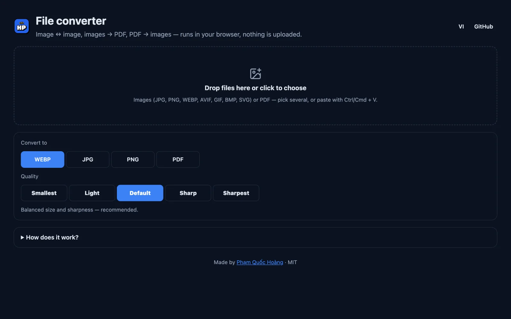

# Image Converter

Đổi định dạng và nén ảnh **ngay trên trình duyệt** — ảnh không được tải lên server nào.
Change image format and compress images **right in your browser** — nothing is uploaded.

**Demo:** https://hoangpham.is-a.dev/image-converter/



## Tính năng / Features

- Kéo thả, chọn file hoặc **dán (Ctrl/Cmd + V)**, nhiều ảnh cùng lúc — *drag & drop, picker or paste, many at once*
- Đổi sang **WebP, JPG, PNG** (và **AVIF** nếu trình duyệt hỗ trợ) — *convert to WebP, JPG, PNG (and AVIF when supported)*
- Nén với 3 mức: **Nhẹ nhất · Cân bằng · Nét nhất** — *three compression levels: Smallest · Balanced · Sharpest*
- Hiện dung lượng trước/sau và % giảm — *shows size before/after and % saved*
- Tải từng ảnh hoặc **tải tất cả thành ZIP** — *download one by one or everything as a ZIP*
- Giao diện **Việt / Anh**, tự theo chế độ sáng/tối — *Vietnamese / English UI, follows light/dark mode*

## Cách hoạt động / How it works

Ảnh được vẽ lên `<canvas>` rồi xuất lại bằng `canvas.toBlob()` theo định dạng và chất lượng đã chọn.
Không dùng thư viện, không cần build — chỉ HTML, CSS và JavaScript thuần (file ZIP được tạo bằng `zip.js` tự viết).

Images are drawn onto a `<canvas>` and re-encoded with `canvas.toBlob()` in the chosen format and quality.
No libraries, no build step — plain HTML, CSS and JavaScript (ZIP files come from a small hand-written `zip.js`).

> Lưu ý: GIF động chỉ lấy khung hình đầu; JPEG không có nền trong suốt nên được thay bằng nền trắng.
> Note: animated GIFs keep only the first frame; JPEG has no transparency, so a white background is used.

## Chạy trên máy / Run locally

```bash
git clone https://github.com/hoangpham2263/image-converter.git
cd image-converter
python3 -m http.server 8000
```

Mở / open http://localhost:8000

## License

MIT © [Phạm Quốc Hoàng](https://hoangpham.is-a.dev)
